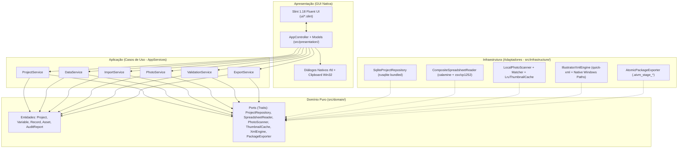
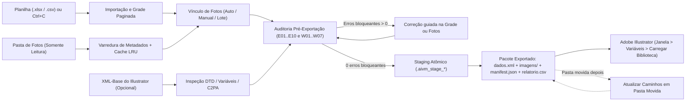
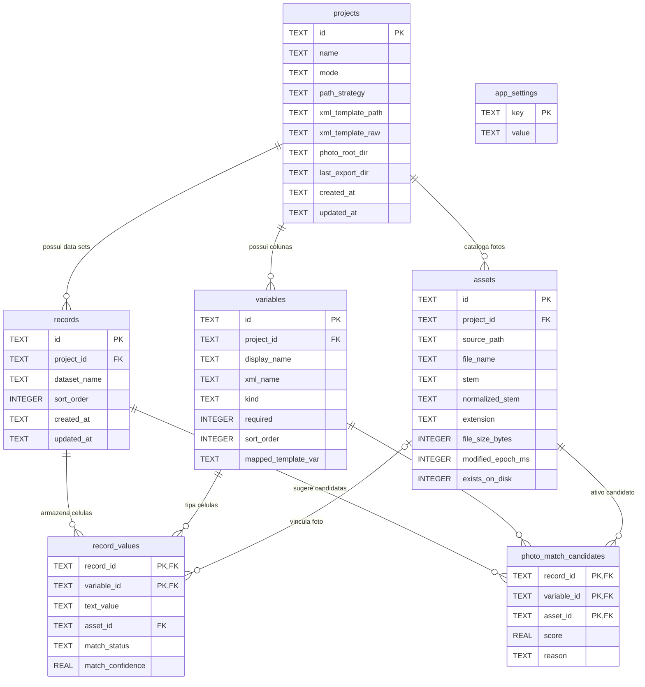
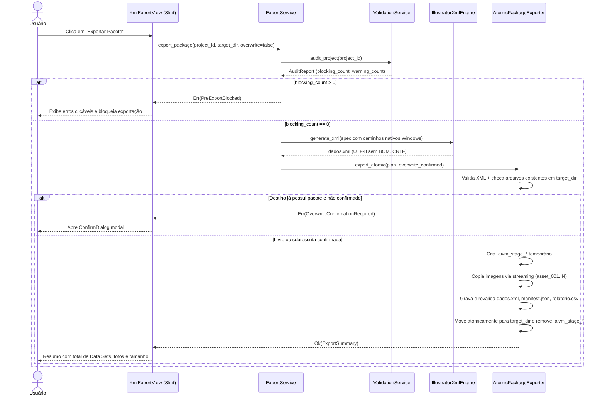

# AI Variable Manager

<p align="center">
  <strong>Gerenciador desktop nativo, 100% offline e determinístico de dados variáveis e fotografias para o painel <em>Variáveis (Variables)</em> do Adobe Illustrator no Windows.</strong>
</p>

<p align="center">
  
  
  
  
  
  
</p>

---

## Sumário

- [Visão Geral e Problema Resolvido](#visão-geral-e-problema-resolvido)
- [Escopo do Projeto e Garantias Fundamentais](#escopo-do-projeto-e-garantias-fundamentais)
- [Conceitos-Chave do Domínio](#conceitos-chave-do-domínio)
- [Arquitetura e Diagramas](#arquitetura-e-diagramas)
  - [Arquitetura Hexagonal (Clean Architecture)](#1-arquitetura-hexagonal-clean-architecture)
  - [Pipeline Completo de Trabalho](#2-pipeline-completo-de-trabalho)
  - [Modelo de Dados SQLite (EAV Dinâmico)](#3-modelo-de-dados-sqlite-eav-dinâmico)
  - [Sequência de Auditoria e Exportação Atômica](#4-sequência-de-auditoria-e-exportação-atômica)
- [Funcionalidades por Tela](#funcionalidades-por-tela)
- [Formato do XML e Pacote Exportado](#formato-do-xml-e-pacote-exportado)
- [Auditoria Pré-Exportação (`E01..E10` e `W01..W07`)](#auditoria-pré-exportação-e01e10-e-w01w07)
- [Stack Tecnológica e Dependências](#stack-tecnológica-e-dependências)
- [Estrutura do Repositório](#estrutura-do-repositório)
- [Instalação e Execução](#instalação-e-execução)
- [Guia Passo a Passo no Adobe Illustrator](#guia-passo-a-passo-no-adobe-illustrator)
- [Testes Automatizados e Verificação](#testes-automatizados-e-verificação)
- [Documentação Complementar](#documentação-complementar)

---

## Visão Geral e Problema Resolvido

Na produção gráfica em lote no **Adobe Illustrator** — como crachás funcionais, credenciais de eventos, certificados, carteirinhas e etiquetas personalizadas — o painel nativo **Variáveis (*Variables*)** permite gerar centenas de artes a partir de uma biblioteca XML (*Variable Library*). Na prática diária, porém, montar esse XML manualmente a partir de planilhas e pastas de fotografias costuma gerar erros recorrentes:

- **Perda de formatação e codificação**: planilhas CSV/Excel corrompem acentos (`Windows-1252` vs. `UTF-8`), removem zeros à esquerda em matrículas/CPFs (`00105` vira `105`) ou quebram delimitadores (`,` vs. `;`).
- **Vínculo manual frágil de fotografias**: arquivos chegam com acentos diferentes, espaços duplicados, extensões variadas (`.jpg`, `.jpeg`, `.png`, `.tif`, `.tiff`) ou nomes ligeiramente divergentes da planilha.
- **Erros silenciosos no Illustrator**: um único caractere `&` ou `<` sem escape, uma entidade DTD `&ns_vars;` ausente, um `dataSetName` duplicado ou um caminho de imagem mal formatado (como URIs `file:///` com `%20` ou caminhos relativos instáveis) faz o Illustrator rejeitar toda a biblioteca XML ou deixar quadros de foto vazios.
- **Risco de mutação dos arquivos originais**: scripts improvisados frequentemente renomeiam ou movem as fotografias originais do cliente/equipe.

O **AI Variable Manager** resolve esse fluxo ponta a ponta em um único aplicativo desktop nativo para Windows (sem WebView, sem Electron e sem serviços externos): importa e organiza os dados em grade editável, vincula fotografias de forma determinística e visual, executa uma auditoria pré-exportação rigorosa e gera um pacote autossuficiente pronto para carregar no Adobe Illustrator.

---

## Escopo do Projeto e Garantias Fundamentais

| Pilar | Garantia Implementada |
|---|---|
| **100% Nativo e Leve** | Binário nativo x64 em **Rust + Slint 1.18 (Fluent Design)** com suporte automático aos temas **Sistema**, **Claro** e **Escuro**. Zero WebView, Electron ou Tauri. |
| **100% Offline e Privado** | Nenhuma chamada de rede, nenhuma telemetria, nenhuma API externa. Todos os projetos ficam em um único banco SQLite local (`%LOCALAPPDATA%\AI Variable Manager\data\aivm.db`). |
| **Fontes Estritamente Somente Leitura** | Planilhas (`.xlsx`, `.csv`), pastas de fotografias e XMLs-base do Illustrator **nunca** são modificados, renomeados ou removidos. |
| **Determinismo e Segurança** | Regras explícitas de normalização, ordenação e auditoria; confirmações modais para ações destrutivas (exclusão de projeto, colunas, registros ou sobrescrita de pacote). |
| **Memória Controlada em Grandes Lotes** | Grade paginada (`50` registros/página), varredura de imagens por metadados (sem decodificar originais em alta resolução), cópia via *streaming* na exportação e cache LRU de miniaturas limitado a **192 entradas (`96×96`)** decodificadas fora da thread da UI. |
| **Compatibilidade Real com Illustrator (Windows)** | Emissão estrita em **UTF-8 sem BOM**, quebras **CRLF (`\r\n`)**, escape XML completo (`& < > " '`), preservação byte a byte de DTDs/entidades Adobe e blocos `<c2pa:manifest>`, suporte a modelos legados (`trait="textcontent"` sem `<p>`) e caminhos absolutos nativos do Windows (`D:\Pasta\imagens\asset_001.jpg`). |

---

## Conceitos-Chave do Domínio

### 1. Projetos, Colunas (Variáveis) e Data Sets
- **Projeto (`Project`)**: unidade de trabalho isolada no SQLite, contendo sua própria estrutura de colunas, registros, catálogo de fotografias escaneadas e configuração de XML.
- **Variável / Coluna (`Variable`)**: representa um campo dinâmico da arte no Illustrator. Possui rótulo amigável (`display_name`), identificador XML validado como `NCName` (`xml_name`), obrigatoriedade (`required`) e tipo:
  - **`Text`**: texto simples ou multilinha (emitido como `<Tag><p>conteúdo</p></Tag>`).
  - **`LinkedFile`**: referência a fotografia vinculada (emitida como `<Tag>D:\Pasta\imagens\asset_001.jpg</Tag>` sem envoltório `<p>`).
- **Registro / Data Set (`Record`)**: corresponde a uma arte final no Illustrator (`<v:sampleDataSet dataSetName="...">`), identificado por um `dataset_name` único e ordenação explícita (`sort_order`).

### 2. Dois Modos de Operação XML
- **Modo Direto (`ProjectMode::WithoutTemplate`)**: o usuário cria ou importa colunas livremente e o aplicativo sintetiza um documento SVG + `variableSet` padrão Adobe completo com as 6 entidades DTD obrigatórias.
- **Modo XML com Modelo do Illustrator (`ProjectMode::WithTemplate`)**: o usuário importa um XML previamente salvo pelo painel *Variables* do próprio documento `.ai`. O motor preserva **byte a byte** declaração XML, `<!DOCTYPE svg [...]>`, metadados XMP / `<c2pa:manifest>`, declarações `<variables>` e variáveis avançadas (`visibility`, `graphdata`), substituindo **exclusivamente** o conteúdo interno de `<v:sampleDataSets>`.

### 3. Persistência EAV Dinâmica (Zero DDL em Runtime)
Em vez de executar `ALTER TABLE` a cada coluna criada ou renomeada pelo usuário, o banco utiliza o padrão **Entity-Attribute-Value (`record_values`)** aliado a `FOREIGN KEY ... ON DELETE CASCADE` e transações `IMMEDIATE`. Isso permite criar, renomear, duplicar, reordenar e excluir colunas dinamicamente sem risco de corrupção de esquema, preservando literais de texto (espaços e zeros à esquerda) exatamente como digitados ou importados.

### 4. Vinculação de Fotografias em 3 Métodos
- **Método A — Match Automático Determinístico**: normaliza nomes de arquivo e chaves da tabela (Unicode NFD→NFC, remoção de diacríticos/acentos, colapso de espaços e *case-insensitive*).
  - Correspondência exata única → vínculo confirmado (`AutoExact`).
  - Empate de mesmo *stem* (ex.: `Ana Silva.jpg` e `Ana Silva.png`) → estado **`Ambiguous`** (bloqueia exportação até desempate humano).
  - Sem exato, mas similaridade **Jaro-Winkler ≥ 0.86** → estado **`AutoSuggested`** com lista ranqueada de candidatas para confirmação manual.
  - Vínculos manuais existentes nunca são sobrescritos pelo match automático, e o texto original da célula é sempre preservado.
- **Método B — Vínculo Manual por Registro**: seletor nativo do Windows (`rfd`) validando extensão e cabeçalho real do arquivo de imagem (`.jpg`, `.jpeg`, `.png`, `.tif`, `.tiff`) antes de registrar o vínculo.
- **Método C — Pool de Fotos sem Uso e Vínculo em Lote**: exibe todas as fotografias escaneadas ainda não associadas a nenhum registro, com filtro por nome e vínculo unitário ou em lote para múltiplos registros marcados.

### 5. Exportação Atômica e Caminhos Absolutos Nativos do Windows
Experimentos práticos no Adobe Illustrator para Windows demonstraram que caminhos relativos (`imagens/asset_001.jpg`) são instáveis dependendo do diretório de trabalho do `.ai` e que URIs `file:///...` com *percent-encoding* (`%20`, `%C3%A1`) falham ao carregar arquivos em pastas com espaços ou acentos. Por isso, o **AI Variable Manager**:
- Copia apenas as fotografias efetivamente vinculadas para `<pasta_destino>\imagens\asset_001.ext` (via *streaming* `std::io::copy`, sem recompressão).
- Emite no `dados.xml` exclusivamente o **caminho absoluto nativo do Windows** com barras invertidas `\` e UTF-8 literal (ex.: `D:\Downloads\crachás teste\imagens\asset_015.jpg`).
- Prepara todos os artefatos em um diretório temporário `.aivm_stage_*`, revalida a estrutura XML em disco e só então promove os arquivos para a pasta final.
- Oferece a ferramenta **Atualizar Caminhos das Imagens em Pasta Movida**, que reescreve atomicamente `dados.xml` e `manifest.json` caso o pacote seja movido para outro diretório ou computador.

---

## Arquitetura e Diagramas

### 1. Arquitetura Hexagonal (Clean Architecture)



### 2. Pipeline Completo de Trabalho



### 3. Modelo de Dados SQLite (EAV Dinâmico)



### 4. Sequência de Auditoria e Exportação Atômica



---

## Funcionalidades por Tela

1. **Projetos (`projects_view.slint`)**
   - Criação em *Modo Direto* ou *Modo XML com Modelo do Illustrator*.
   - Listagem ordenada pelos projetos mais recentes com contagem de registros e colunas, abertura rápida, renomeio inline e exclusão com diálogo de confirmação modal.
2. **Dados e Colunas (`data_grid_view.slint`)**
   - Grade paginada (`50` linhas/página) com edição direta de `dataSetName` e células, reordenação de linhas (`▲`/`▼`), seleção múltipla e exclusão confirmada.
   - Diagnósticos visuais imediatos por célula (obrigatória vazia, duplicada, foto confirmada/sugerida/ambígua/ausente) e atalho rápido `...` para vincular foto na própria célula.
   - Gerenciador de colunas (`Texto` ou `Fotografia`, obrigatoriedade, edição de tag XML, duplicação com cópia de valores, reordenação e exclusão).
   - **Colagem em Bloco** direto da área de transferência do Windows (`Ctrl+C` via Win32 `CF_UNICODETEXT`) ou caixa de revisão manual, expandindo linhas automaticamente.
   - **Assistente de Importação `.xlsx` / `.csv`**: seleção de aba Excel, linha de cabeçalho configurável, prévia das primeiras linhas, mapeamento por coluna (`Ignorar`, `Criar Texto`, `Criar Foto`, `Mapear Existente`) e modo `Adicionar` ou `Substituir`.
3. **Fotos e Vínculos (`photos_view.slint`)**
   - Varredura recursiva somente leitura da pasta de fotografias com barra de KPIs (`Confirmadas`, `Sugestões`, `Ambíguas`, `Sem Foto`, `Sobras na Pasta`, `Duplicadas`, `Ausentes no Disco`).
   - Cada item da lista exibe `Registro_xxxx`, status, **resumo compacto de todas as demais colunas do registro** (ex.: `Nome: Ana Souza  •  Cargo: Designer  •  Setor: SECOM`) logo abaixo do nome, miniatura `96×96` carregada sob demanda e botões `Escolher...` / `Desvincular`.
   - Painel contextual à direita mostrando os dados completos do registro selecionado, candidatas de match com pontuação de confiança para confirmação e **Pool de Fotos sem Uso** filtrável para vínculo unitário ou em lote.
4. **XML e Exportação (`xml_export_view.slint`)**
   - Alternância de modo do projeto, carregamento de XML-base do Illustrator (exibindo `varSetName`, quantidade de amostras e preservação de C2PA) e mapeamento de cada variável do XML para colunas do projeto.
   - **Auditoria Pré-Exportação** com itens clicáveis que navegam diretamente à aba/linha/coluna do problema.
   - **Exportação do Pacote Portátil**, **Prévia do `dados.xml`** usando a pasta de destino selecionada e ferramenta **Atualizar Caminhos das Imagens em Pasta Movida**.
5. **Configurações (`settings_view.slint`)**
   - Seletor de tema Fluent (`Seguir Windows`, `Tema Claro`, `Tema Escuro`), monitoramento e limpeza do cache LRU de miniaturas (`0 / 192`), caminho do banco SQLite local e guia rápido do Adobe Illustrator.

---

## Formato do XML e Pacote Exportado

Ao exportar para uma pasta como `D:\Downloads\crachás teste`, o aplicativo gera atomicamente:

```text
D:\Downloads\crachás teste\
├── dados.xml          # Biblioteca XML pronta para o Adobe Illustrator (UTF-8 sem BOM, CRLF)
├── manifest.json      # Metadados do pacote e mapa de arquivos (usado ao mover a pasta)
├── relatorio.csv      # Relatório por registro (record_id, dataset_name, status, imagens, avisos)
└── imagens\
    ├── asset_001.jpg
    ├── asset_002.png
    └── ...
```

### Exemplo de `dados.xml` gerado

```xml
<?xml version="1.0" encoding="utf-8"?>
<!DOCTYPE svg PUBLIC "-//W3C//DTD SVG 20001102//EN"
  "http://www.w3.org/TR/2000/CR-SVG-20001102/DTD/svg-20001102.dtd" [
  <!ENTITY ns_graphs "http://ns.adobe.com/Graphs/1.0/">
  <!ENTITY ns_vars "http://ns.adobe.com/Variables/1.0/">
  <!ENTITY ns_imrep "http://ns.adobe.com/ImageReplacement/1.0/">
  <!ENTITY ns_custom "http://ns.adobe.com/GenericCustomNamespace/1.0/">
  <!ENTITY ns_flows "http://ns.adobe.com/Flows/1.0/">
  <!ENTITY ns_extend "http://ns.adobe.com/Extensibility/1.0/">
]>
<svg>
  <variableSets xmlns="&ns_vars;">
    <variableSet locked="none" varSetName="CrachasCorporativos">
      <variables>
        <variable varName="nome" trait="textcontent" category="&ns_flows;"></variable>
        <variable varName="funcao" trait="textcontent" category="&ns_flows;"></variable>
        <variable varName="foto" trait="fileref" category="&ns_vars;"></variable>
      </variables>
      <v:sampleDataSets xmlns="&ns_custom;" xmlns:v="&ns_vars;">
        <v:sampleDataSet dataSetName="Registro_0001">
          <nome><p>Ana Souza &amp; Silva</p></nome>
          <funcao><p>Designer Sênior</p></funcao>
          <foto>D:\Downloads\crachás teste\imagens\asset_001.jpg</foto>
        </v:sampleDataSet>
      </v:sampleDataSets>
    </variableSet>
  </variableSets>
</svg>
```

> **Modelos legados do Illustrator**: alguns XMLs gerados por versões anteriores do Illustrator declaram a variável de foto com `trait="textcontent"`, porém sem envolver o caminho em `<p>` nas amostras. O motor detecta automaticamente `sample_uses_p_wrapper == Some(false)` durante a inspeção e emite `<foto>D:\...\imagens\asset_001.jpg</foto>` sem `<p>`.

---

## Auditoria Pré-Exportação (`E01..E10` e `W01..W07`)

| Código | Severidade | Regra Auditada |
|---|---|---|
| `E01` | Bloqueante | Projeto sem colunas ou sem registros. |
| `E02` | Bloqueante | Identificador XML (`xml_name`) inválido como `NCName` ou duplicado. |
| `E03` | Bloqueante | `dataSetName` vazio ou duplicado entre registros. |
| `E04` | Bloqueante | Campo de texto obrigatório está vazio. |
| `E05` | Bloqueante | Campo de fotografia obrigatório sem vínculo confirmado (ou apenas sugestão pendente). |
| `E06` | Bloqueante | Arquivo de fotografia vinculado não existe mais no disco. |
| `E07` | Bloqueante | Fotografia vinculada em formato não suportado ou arquivo vazio (`0` bytes). |
| `E08` | Bloqueante | *Modo XML com Modelo* ativo sem XML-base válido vinculado. |
| `E09` | Bloqueante | Variável esperada no XML-base sem mapeamento, mapeamento duplicado ou tipo incompatível. |
| `E10` | Bloqueante | Vínculo de fotografia em estado **Ambíguo** pendente de desempate manual. |
| `W01` | Aviso | Campo de texto ou fotografia opcional vazio / sem vínculo. |
| `W02` | Aviso | Sugestão automática de fotografia pendente em coluna opcional. |
| `W03` | Aviso | Valor de texto duplicado em múltiplos registros. |
| `W04` | Aviso | Mesma fotografia associada a mais de um registro. |
| `W05` | Aviso | Fotografias escaneadas na pasta sem uso (não serão copiadas para o pacote). |
| `W06` | Aviso | Pasta de destino já contém arquivos de exportação (solicitará confirmação de sobrescrita). |
| `W07` | Aviso | Variável avançada do XML-base (`visibility` / `graphdata`) preservada sem edição no MVP. |

---

## Stack Tecnológica e Dependências

| Camada | Tecnologia / Crate | Papel |
|---|---|---|
| Linguagem | **Rust** (`edition = "2024"`, MSRV `1.88`) | Performance nativa, segurança de memória e binário único. |
| Interface Desktop | `slint = "1.18"` (`fluent`, `backend-winit`, `renderer-femtovg`, `renderer-software`, `accessibility`) + `slint-build = "1.18"` | GUI nativa Windows 10/11 com temas Sistema/Claro/Escuro e renderização headless testável. |
| Persistência | `rusqlite = "0.42"` (`bundled`) | SQLite embutido transacional sem DLL externa. |
| Planilhas | `calamine = "0.38"`, `csv = "1.4"` | Leitura `.xlsx`/`.xlsm` preservando zeros à esquerda + CSV com detecção de delimitador, UTF-8 BOM e fallback `Windows-1252`. |
| XML | `quick-xml = "0.41"` | Inspeção rigorosa, validação de entidades DTD, *splicing* cirúrgico de `<v:sampleDataSets>` e reescrita de caminhos. |
| Mídia & Match | `walkdir = "2.5"`, `image = "0.25"` (`jpeg`, `png`, `tiff`), `unicode-normalization = "0.1"`, `strsim = "0.11"` | Scanner somente leitura, cache LRU de miniaturas `96×96` off-thread, normalização pt-BR e Jaro-Winkler. |
| Sistema & Diálogos | `rfd = "0.17"`, `directories = "6.0"`, `tempfile = "3.27"`, Win32 FFI (`user32`/`kernel32`) | Diálogos nativos de arquivo/pasta, `%LOCALAPPDATA%`, staging atômico e leitura de clipboard. |
| Erros, Logs & Serialização | `thiserror = "2.0"`, `serde = "1.0"`, `serde_json = "1.0"`, `uuid = "1.29"`, `tracing = "0.1"`, `tracing-subscriber = "0.3"` | Erros amigáveis em pt-BR, `manifest.json`, UUIDv4 e logs estruturados. |
| Instalador Windows | **Inno Setup 6** (`installer/ai-variable-manager.iss`) | Empacotamento x64 em Português (Brasil) com compressão LZMA2 e atalhos. |

---

## Estrutura do Repositório

```text
AI Variable Manager/
├── assets/                     # Ícone multi-resolução (app.ico) e metadados Win32 (app.rc)
├── docs/                       # Documentação técnica detalhada
│   ├── architecture.md         # Detalhes das camadas e decisões arquiteturais
│   ├── compatibility.md        # Matriz de compatibilidade e roteiro manual no Illustrator
│   ├── development.md          # Setup de desenvolvimento, testes e build
│   └── xml_format.md           # Especificação XML, entidades DTD e pacote portátil
├── installer/                  # Script Inno Setup 6 e instalador compilado
│   ├── ai-variable-manager.iss
│   └── output/AI_Variable_Manager_Setup_0.1.0_x64.exe
├── src/
│   ├── main.rs                 # Entrypoint GUI Windows, logging e bootstrap do AppController
│   ├── lib.rs                  # Exportações públicas e container AppServices
│   ├── domain/                 # Entidades puras, diagnósticos, validações e traits (ports)
│   ├── application/            # Serviços de aplicação (Project, Data, Import, Photo, Validation, Export)
│   ├── infrastructure/         # Adaptadores SQLite, XLSX/CSV/Clipboard, Media/LRU, XML e Packager
│   ├── presentation/           # AppController, modelos Slint, diálogos rfd e clipboard Win32
│   └── shared/                 # AppError amigável, normalização Unicode/NCName e UTC time
├── tests/
│   ├── fixtures/               # XMLs de referência, planilhas sintéticas e imagens de teste
│   ├── m1_persistence.rs       # Testes de persistência SQLite, concorrência e rollback (15)
│   ├── xml_compat_tests.rs     # Compatibilidade com fixtures Illustrator + teste opcional LAN (3+1)
│   ├── ui_theme_tests.rs       # Validação de contraste Dark/Light/Sistema e colunas na FotosView (1)
│   └── e2e/                    # Suíte E2E completa Tiers 1–4 incluindo volume 1.000×1.000 (246)
├── ui/                         # Interface nativa Slint Fluent
│   ├── app.slint               # Janela principal AppWindow
│   ├── theme/tokens.slint      # Structs de dados e tokens semânticos Dark/Light
│   ├── components/             # Sidebar, Toolbar, StatusBar, ConfirmDialog
│   └── views/                  # ProjectsView, DataGridView, PhotosView, XmlExportView, SettingsView
├── build.rs                    # Compilação Slint Fluent + recursos Win32 via rc.exe
└── Cargo.toml
```

---

## Instalação e Execução

### Usuário Final (Windows 10/11 64-bit)
- **Via Instalador**: execute `installer/output/AI_Variable_Manager_Setup_0.1.0_x64.exe` (instalação por usuário ou administrador, em português).
- **Via Executável Portátil**: execute diretamente `target/release/ai-variable-manager.exe`.
- Os projetos são salvos automaticamente em `%LOCALAPPDATA%\AI Variable Manager\data\aivm.db`.

### Desenvolvimento Local

#### Pré-requisitos
- **Rust 1.88+** com toolchain `x86_64-pc-windows-msvc`
- **Visual Studio Build Tools 2022** e **Windows 10/11 SDK** (`rc.exe`)
- **Inno Setup 6** (`ISCC.exe`) — opcional, necessário apenas para gerar o instalador `.exe`

#### Comandos principais
```powershell
# Executar em modo desenvolvimento (sem gerar binário Release)
cargo run

# Análise estática (Clippy)
cargo clippy --all-targets --features e2e_tests

# Compilar binário otimizado de Release (sem janela de console)
cargo build --release

# Compilar instalador Windows x64 com Inno Setup 6
& "$env:LOCALAPPDATA\Programs\Inno Setup 6\ISCC.exe" installer\ai-variable-manager.iss
```

---

## Guia Passo a Passo no Adobe Illustrator

1. Crie um projeto no **AI Variable Manager** (*Modo Direto* ou *Modo XML com Modelo*).
2. Cadastre ou importe seus registros (`.xlsx`, `.csv` ou colagem `Ctrl+C`) na aba **Dados e Colunas**.
3. Na aba **Fotos e Vínculos**, selecione a pasta de fotografias, execute **Match Automático** e finalize eventuais sugestões, ambiguidades ou vínculos manuais comparando com as colunas exibidas abaixo de cada registro.
4. Na aba **XML e Exportação**, clique em **Executar Auditoria** (garanta `0` erros bloqueantes), escolha uma pasta de saída e clique em **Exportar Pacote**.
5. No **Adobe Illustrator**, abra seu documento `.ai` e acesse **Janela > Variáveis** (*Window > Variables*).
6. No menu do painel **Variáveis**, clique em **Carregar Biblioteca de Variáveis...** (*Load Variable Library...*) e selecione o arquivo `dados.xml` exportado.
7. Navegue pelos *Data Sets* para conferir texto, acentuação e fotografias vinculadas antes de executar o lote final (*Batch / Actions*).
8. **Moveu a pasta exportada depois?** Abra **XML e Exportação > Atualizar Caminhos das Imagens em Pasta Movida**, aponte para o novo local e clique em **Atualizar dados.xml**.

---

## Testes Automatizados e Verificação

Execute toda a suíte offline com um único comando:

```powershell
cargo test --lib --tests --features e2e_tests
```

| Suíte | Quantidade | Cobertura |
|---|---|---|
| Unitários (`src/`) | **27** | Validações de domínio, `NCName`, normalização pt-BR, parser CSV/`cp1252`, XLSX, clipboard, caminhos nativos Windows, SQLite. |
| Persistência (`tests/m1_persistence.rs`) | **15** | Ciclo de vida, EAV com zeros à esquerda, rollback atômico, concorrência multi-thread, `ON DELETE CASCADE`, sanitização de erros. |
| Compatibilidade XML (`tests/xml_compat_tests.rs`) | **3 offline** (+1 opcional LAN) | Fixtures SECOM, C2PA (`segunda_leva_variant.xml`), legado `bombeiro_reference.xml` sem `<p>`, CRLF/UTF-8 sem BOM, caminhos Windows e atualização pós-movimentação. |
| Interface & Contraste (`tests/ui_theme_tests.rs`) | **1** | Renderização headless via `MinimalSoftwareWindow`, contraste Escuro/Claro/Sistema e exibição das colunas na tela `Fotos e Vínculos`. |
| E2E Tiers 1–4 (`tests/e2e_runner.rs`) | **246** | Todas as funcionalidades (`F-01..F-26`), fronteiras/erros, combinações multi-etapa e teste de volume **`1.000 registros × 1.000 fotos`** com cache LRU limitado a `192`. |
| **Total Offline** | **292 testes** | **100% determinísticos e independentes de rede.** |

---

## Documentação Complementar

- [docs/architecture.md](docs/architecture.md) — Arquitetura detalhada em camadas e garantias de segurança de dados.
- [docs/xml_format.md](docs/xml_format.md) — Especificação do XML Adobe Illustrator, entidades DTD, C2PA e estrutura do pacote.
- [docs/compatibility.md](docs/compatibility.md) — Matriz de formatos suportados, códigos da auditoria e roteiro manual no Illustrator.
- [docs/development.md](docs/development.md) — Guia de build, testes e empacotamento Windows.
